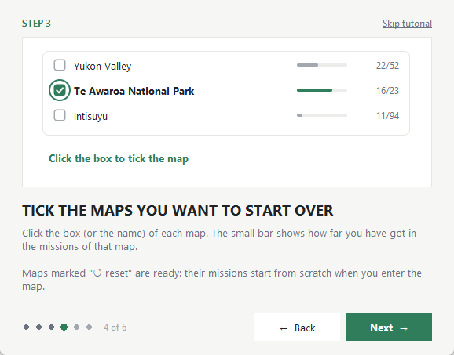
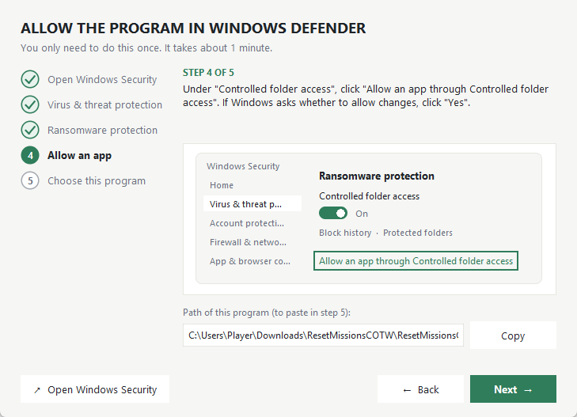
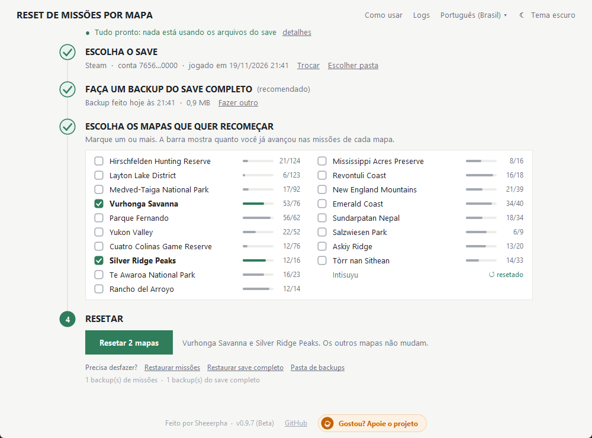
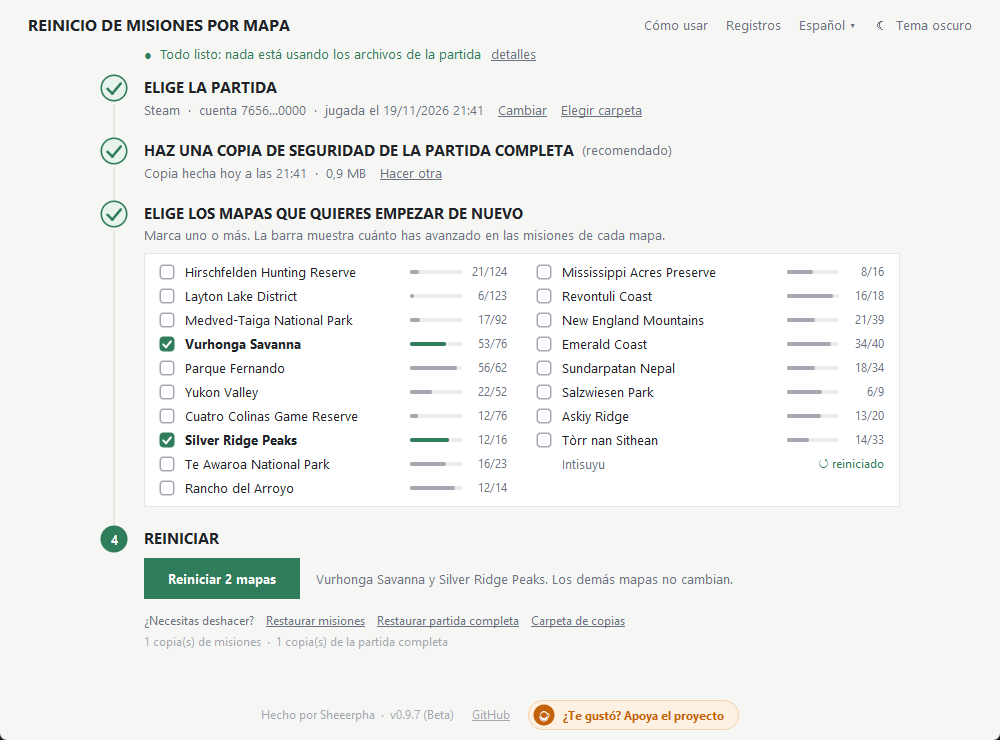

<div align="center">

# 🎯 ResetMissionsCOTW

### Start over the missions of **one map** in theHunter: Call of the Wild, without losing the others.

[](https://github.com/Sheeerpha/ResetMissionsCOTW/releases/latest)
[](https://github.com/Sheeerpha/ResetMissionsCOTW/releases)
[](#%EF%B8%8F-download)
[](LICENSE)

**English** · [Português](#-português) · [Español](#-español)


</div>

---

## 🤔 The problem

Finished all the missions of a reserve and want to play them again? The game has no button for that. The only way is to delete the missions file, and that wipes the mission progress of **every map at once**.

|                        | Deleting the file (the game's way) | **ResetMissionsCOTW** |
|------------------------|:----------------------------------:|:---------------------:|
| Choose which maps      | ❌ all of them, always              | ✅ one, several or all |
| Other maps             | ❌ lost                             | ✅ untouched           |
| Backup before changing | ❌ you have to remember             | ✅ automatic           |
| Undo                   | ❌                                  | ✅ one click           |

Only the **mission progress** of the maps you pick changes. Your profile, money, skills, perks, weapons, animals, trophies and everything else stay exactly as they are.

---

## ⬇️ Download

1. Go to **[Releases → latest version](https://github.com/Sheeerpha/ResetMissionsCOTW/releases/latest)** and download `ResetMissionsCOTW_vX.X.X-beta.zip`.
2. Right-click the `.zip` → **Extract All...**
3. Open `ResetMissionsCOTW.exe`. Nothing to install.

> 📄 The zip comes with `README_FIRST.txt`, a step-by-step guide in plain language (also in Portuguese and Spanish).

### 🛡️ "Windows protected your PC"? This is normal

The first time, Windows will probably show a blue screen. It shows up for **every program without a paid code-signing certificate** (something big companies buy every year). This is a free program made by a player, so it does not have one. It does not mean it has a virus.

**To continue:** click **More info** → **Run anyway**. Usually only the first time.

Want to be sure? All the code is right here, and the `.exe` in Releases is **built automatically by GitHub** from this code.

---

## 🚀 How to use: 4 steps

Close the game, open the program and follow the window from top to bottom:

| Step | What you do |
|:---:|---|
| **1** | **Choose the save.** It is found automatically (Steam or Epic), already picking the one you played last. |
| **2** | **Back up the full save** *(recommended)*. One click copies the whole save folder. |
| **3** | **Tick the maps** you want to start over. A small bar shows your progress on each one. |
| **4** | **Reset.** Then open the game and enter the map: its missions start from scratch. |

> ☁️ **Steam Cloud / Epic Cloud:** if the game asks which save version to use, choose **LOCAL** (this computer). Choosing the cloud one undoes the reset.

**Changed your mind?** Right below the Reset button: **Restore missions** or **Restore full save**.

---

## ✨ Features

**🔒 Safe**
- Automatic backup of the missions file before every change (keeps 50) and a **full save backup** button (keeps 5). The very first backup of each kind is never deleted.
- Writes to a temporary file, re-reads it and checks everything byte by byte before replacing the real file.
- Will not change anything while the game is open.
- **Check before you start:** finds what could get in the way (the game, Steam, OneDrive, Google Drive, Dropbox, cloud folders, read-only files) and offers buttons like *Close Steam* or *Fix*. It never closes anything on its own or by force.

**🧭 Simple**
- One window, 4 numbered steps. What is done gets a ✓, what is next turns green.
- A 6-screen illustrated tutorial the first time (reopen it anytime with *How to use*).
- An illustrated guide if Windows Defender's *Controlled folder access* blocks the program.
- Portuguese, English and Spanish · light and dark theme (follows Windows).

**🔔 Up to date**
- Tells you when a new version is published here (checks at most once a day, sends no personal data, and never downloads anything by itself).

**🧾 Transparent**
- Free and open source (MIT).
- Local logs with personal data masked, plus *Copy details* in error windows, to make bug reports easy.

---

## 🖼️ Screenshots

| Dark theme | Tutorial |
|:---:|:---:|
|  |  |
| **"Before you start"** | **Windows Defender guide** |
|  |  |

---

## ❓ FAQ

<details>
<summary><b>Will I lose progress on other maps?</b></summary>

No. Only the missions of the maps you tick are reset. Every other map keeps its missions, and nothing outside the missions (money, weapons, trophies...) is touched.
</details>

<details>
<summary><b>Can I undo a reset?</b></summary>

Yes. A missions backup is made automatically before every reset. Use **Restore missions**: the window highlights in yellow what will change before you confirm. You can also restore the whole save from a full backup.
</details>

<details>
<summary><b>Where are the backups?</b></summary>

In `Documents\.BKP_ResetMissions_Saves_COTW` (a hidden folder), separated by account: `Backups_MISSIONS` and `Backups_SAVE`. The program has a **Backups folder** link that opens it.
</details>

<details>
<summary><b>Does it work with the Epic Games version?</b></summary>

It should: the program also finds Epic saves. It has been tested on Steam so far, so feedback from Epic players is very welcome.
</details>

<details>
<summary><b>A yellow notice says Windows is blocking the program</b></summary>

That is Windows Defender's *Controlled folder access* (ransomware protection), which protects the Documents folder where the save is. Click **How to allow it (step by step)**: the program shows 5 illustrated steps and a button to copy its own path. It takes about a minute and only once. If you move the program to another folder later, allow it again.
</details>

<details>
<summary><b>Does the program connect to the internet?</b></summary>

Only to ask this GitHub page which is the latest published version (at most once a day), so it can tell you about updates. No personal data is sent, nothing is downloaded automatically, and without internet it simply skips the check.
</details>

<details>
<summary><b>How does it work? (technical)</b></summary>

`missions_missiondata_adf` is a 32-byte `SAVE`/`COMP` header followed by a zlib stream holding an Avalanche ADF file. Its root, `MissionManager_1`, has a hash table `Campaigns` keyed by **map id** (the same numbers as the `animal_population_N` files). Resetting a map removes that map's entry from the table (unlinking it from its bucket chain and returning it to the free list), so only about 6 bytes change. The game recreates the map's missions from scratch the next time you enter it, exactly as for a map you have never visited. Every result is re-opened and compared byte by byte against the expected content before the real file is replaced.
</details>

<details>
<summary><b>Building from source</b></summary>

Requires Python 3.15 on Windows.

```powershell
cd programa
py -3 -m venv .venv
.venv\Scripts\python.exe -m pip install pyinstaller
.venv\Scripts\python.exe -X utf8 testes.py
.venv\Scripts\python.exe -m PyInstaller --onefile --windowed --name ResetMissionsCOTW cotw_app.py
```

The tests generate synthetic saves on the fly, so no real save is needed. Releases are built by GitHub Actions (`.github/workflows/release.yml`) when a release is published.
</details>

---

## 🐞 Found a bug? Have an idea?

Open an **[Issue](https://github.com/Sheeerpha/ResetMissionsCOTW/issues)** with a screenshot, what you did before it happened and the log (click **Logs** in the program, or **Copy details** in the error window).

## ☕ Support

The program is free and always will be. If it saved your progress:

[](https://buymeacoffee.com/sheeerpha)
[-c2620a?style=for-the-badge)](https://livepix.gg/sherpa)

No money to spare? A ⭐ on this page and telling your hunting friends helps a lot too.

---

<sub>Made by **Sheeerpha** · [MIT License](LICENSE) · Fan-made tool, not affiliated with or endorsed by Expansive Worlds or Avalanche Studios. theHunter: Call of the Wild is a trademark of its respective owners. Beta software: back up your save before using it.</sub>

---

## 🇧🇷 Português

### Recomece as missões de **um mapa** do theHunter: Call of the Wild, sem perder os outros.

<div align="center"></div>

**O problema:** o jogo não tem botão para refazer as missões de uma reserva. O único jeito é apagar o arquivo de missões, e isso zera as missões de **todos os mapas de uma vez**.

**A solução:** com o ResetMissionsCOTW você escolhe quais mapas recomeçam. Os outros mapas, o perfil, o dinheiro, as armas, os animais e os troféus **não mudam**.

#### ⬇️ Baixar
1. Abra **[Releases → versão mais recente](https://github.com/Sheeerpha/ResetMissionsCOTW/releases/latest)** e baixe o `.zip`.
2. Clique com o botão direito no `.zip` → **Extrair tudo...**
3. Abra o `ResetMissionsCOTW.exe`. Não precisa instalar nada. O `LEIA-ME_PRIMEIRO.txt` explica tudo passo a passo.

> 🛡️ **"O Windows protegeu o computador" é normal.** Aparece em todo programa sem assinatura digital paga. Clique em **Mais informações** → **Executar assim mesmo**. O código está todo aqui, e o `.exe` é gerado pelo próprio GitHub.

#### 🚀 Como usar: 4 passos
Feche o jogo, abra o programa e siga a janela de cima para baixo:
1. **Escolha o save**: ele é encontrado sozinho (Steam ou Epic).
2. **Faça um backup do save completo** *(recomendado)*.
3. **Marque os mapas** que quer recomeçar.
4. **Resetar.** Abra o jogo (se a nuvem perguntar, escolha **LOCAL**) e entre no mapa: as missões começam do zero.

Para desfazer: **Restaurar missões** ou **Restaurar save completo**, logo abaixo do botão.

#### ✨ Destaques
- 🔒 Backup automático antes de cada alteração, conferência byte a byte e nada é alterado com o jogo aberto.
- 🧭 Janela em 4 passos, tutorial ilustrado e guia com desenhos para liberar no Windows Defender.
- 🔔 Avisa quando sai versão nova (sem enviar dados pessoais e sem baixar nada sozinho).
- 🌐 Português, inglês e espanhol · tema claro e escuro.

**Problemas ou ideias?** Abra uma [Issue](https://github.com/Sheeerpha/ResetMissionsCOTW/issues). **Gostou?** Apoie pelo [Buy Me a Coffee](https://buymeacoffee.com/sheeerpha) ou [LivePix](https://livepix.gg/sherpa), ou deixe uma ⭐.

---

## 🇪🇸 Español

### Empieza de nuevo las misiones de **un mapa** de theHunter: Call of the Wild, sin perder los demás.

<div align="center"></div>

**El problema:** el juego no tiene un botón para repetir las misiones de una reserva. La única forma es borrar el archivo de misiones, y eso borra las misiones de **todos los mapas a la vez**.

**La solución:** con ResetMissionsCOTW eliges qué mapas empiezan de nuevo. Los demás mapas, el perfil, el dinero, las armas, los animales y los trofeos **no cambian**.

#### ⬇️ Descargar
1. Abre **[Releases → última versión](https://github.com/Sheeerpha/ResetMissionsCOTW/releases/latest)** y descarga el `.zip`.
2. Haz clic derecho en el `.zip` → **Extraer todo...**
3. Abre `ResetMissionsCOTW.exe`. No hay que instalar nada. El `LEEME_PRIMERO.txt` lo explica todo paso a paso.

> 🛡️ **"Windows protegió su PC" es normal.** Aparece con todo programa sin firma digital de pago. Haz clic en **Más información** → **Ejecutar de todas formas**. Todo el código está aquí, y el `.exe` lo genera el propio GitHub.

#### 🚀 Cómo usarlo: 4 pasos
Cierra el juego, abre el programa y sigue la ventana de arriba abajo:
1. **Elige la partida**: se encuentra sola (Steam o Epic).
2. **Haz una copia de seguridad de la partida completa** *(recomendado)*.
3. **Marca los mapas** que quieres empezar de nuevo.
4. **Reiniciar.** Abre el juego (si la nube pregunta, elige **LOCAL**) y entra en el mapa: las misiones empiezan desde cero.

Para deshacer: **Restaurar misiones** o **Restaurar partida completa**, justo debajo del botón.

#### ✨ Lo más destacado
- 🔒 Copia automática antes de cada cambio, comprobación byte a byte y nada se cambia con el juego abierto.
- 🧭 Ventana en 4 pasos, tutorial ilustrado y guía con dibujos para permitirlo en Windows Defender.
- 🔔 Avisa cuando sale una versión nueva (sin enviar datos personales y sin descargar nada solo).
- 🌐 Portugués, inglés y español · tema claro y oscuro.

**¿Problemas o ideas?** Abre una [Issue](https://github.com/Sheeerpha/ResetMissionsCOTW/issues). **¿Te gustó?** Apóyalo en [Buy Me a Coffee](https://buymeacoffee.com/sheeerpha) o [LivePix](https://livepix.gg/sherpa), o deja una ⭐.
