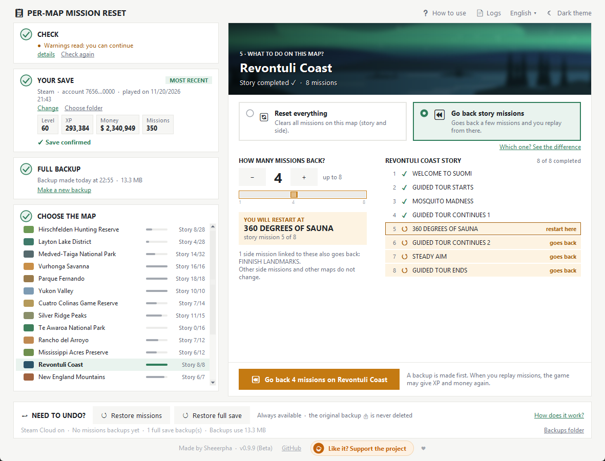
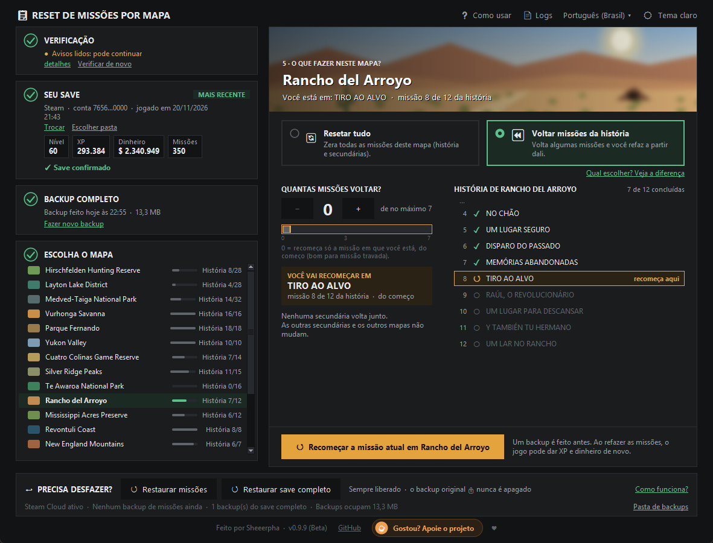
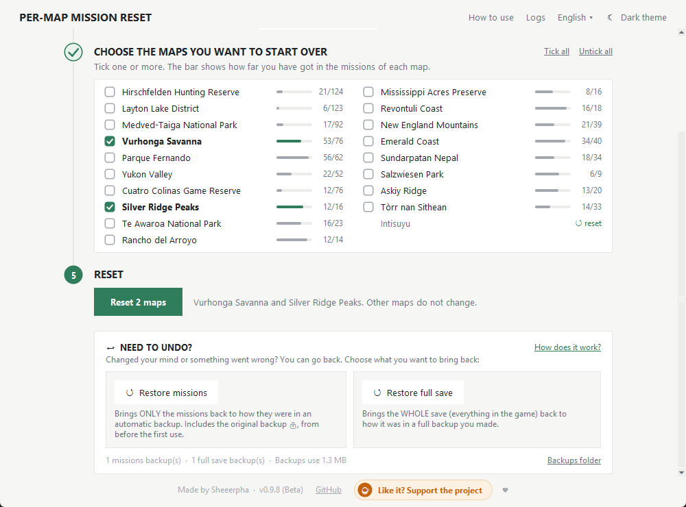
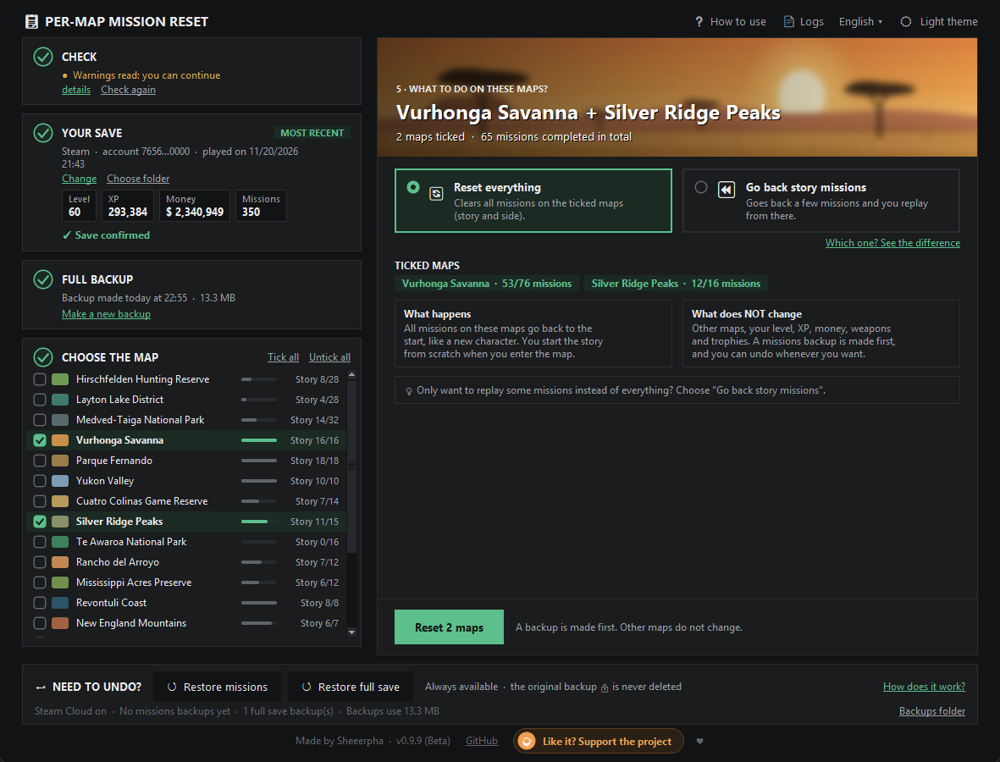
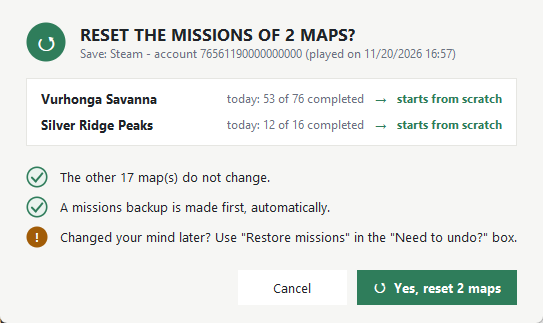
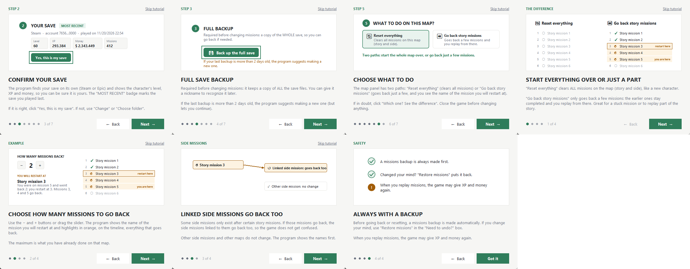
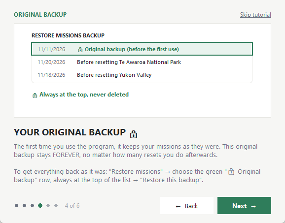
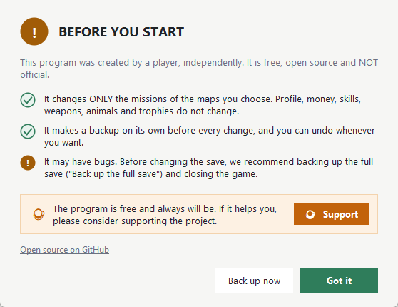

<div align="center">


# ResetMissionsCOTW

### Start over the missions of **one map** in theHunter: Call of the Wild, without losing the others.

[](https://github.com/Sheeerpha/ResetMissionsCOTW/releases/latest)
[](https://github.com/Sheeerpha/ResetMissionsCOTW/releases)
[](#%EF%B8%8F-download)
[](LICENSE)

**English** · [Português](#-português) · [Español](#-español)



</div>

---

## 🤔 The problem

Finished all the missions of a reserve and want to play them again? The game has no button for that. The only way is to delete the missions file, and that wipes the mission progress of **every map at once**.

|                        | Deleting the file (the game's way) | **ResetMissionsCOTW** |
|------------------------|:----------------------------------:|:---------------------:|
| Choose which maps      | ❌ all of them, always              | ✅ one, several or all |
| Go back just a few story missions | ❌                       | ✅ with the mission names |
| Restart a stuck mission | ❌                                 | ✅ from its beginning  |
| Other maps             | ❌ lost                             | ✅ untouched           |
| Backup before changing | ❌ you have to remember             | ✅ automatic           |
| Undo                   | ❌                                  | ✅ one click           |
| Your original missions | ❌ gone                             | ✅ kept forever 🔒     |

Only the **mission progress** of the maps you pick changes. Your profile, money, skills, perks, weapons, animals, trophies and everything else stay exactly as they are.

---

## ⬇️ Download

1. Go to **[Releases → latest version](https://github.com/Sheeerpha/ResetMissionsCOTW/releases/latest)** and download `ResetMissionsCOTW_vX.X.X-beta.zip`.
2. Right-click the `.zip` → **Extract All...**
3. Open `ResetMissionsCOTW.exe`. Nothing to install.

> 📄 The zip comes with `README_FIRST.txt`, a step-by-step guide in plain language (also in Portuguese and Spanish).

### 🛡️ "Windows protected your PC"? This is normal

The first time, Windows will probably show a blue screen. It shows up for **every program without a paid code-signing certificate** (something big companies buy every year). This is a free program made by a player, so it does not have one. It does not mean it has a virus.

**To continue:** click **More info** → **Run anyway**. Usually only the first time.

Want to be sure? All the code is right here, and the `.exe` in Releases is **built automatically by GitHub** from this code.

---

## 🚀 How to use: 5 steps

Close the game, open the program and follow the steps on the left, top to bottom. **Each step unlocks the next one**, so nothing important is skipped:

| Step | What you do |
|:---:|---|
| **1** | **Check.** The program makes sure nothing (the game, Steam, OneDrive…) is using the save files. Blocking problems stop you; simple warnings just ask *I read the warning, continue*. |
| **2** | **Your save.** Found automatically (Steam or Epic), with the character's **level, XP and money** so you know it is yours. Click *Yes, this is my save*. |
| **3** | **Full backup** *(required)*. One click copies the whole save folder; you can give it a name. If your last one is more than 2 days old, it suggests a new one. |
| **4** | **Choose the map.** Each map shows how much of its story you have done (e.g. *Story 5/8*). |
| **5** | **What to do on this map?** Pick one of two options (below), check the confirmation and open the game. |

### Two ways to start over

<div align="center"></div>

- 🔄 **Reset everything** — clears **all** missions of the map (story and side), like a new character. You can tick several maps at once.
- ⏪ **Go back story missions** — the map panel shows *You are on: **mission name***. Use − / + or the slider to choose how many missions to go back, and it shows the **name of the mission you will restart at**, with a timeline of everything that goes back.
  - **0 = restart only the current mission** from its beginning: perfect for a mission that got stuck or bugged.
  - Side missions **linked** to those story missions go back too (their names are shown first); other side missions do not change.
  - Mission names are read from **your own game installation** (nothing from the game is shipped with the program), in your language.
  - If a mission changed in a game update after you played it, the program refuses to go back to it, for safety.
  - Replaying missions may give you XP and money again.

> ☁️ **Steam Cloud / Epic Cloud:** if the game asks which save version to use, choose **LOCAL** (this computer). Choosing the cloud one undoes the change.

**Changed your mind?** At the bottom of the window there is a **Need to undo?** box, always available, with **Restore missions** and **Restore full save**, plus an illustrated *How does it work?* guide.

> 🔒 **Your original missions are always safe.** The first time you use the program, it keeps a backup of your missions as they were. That **original backup is never deleted**, no matter how many resets you do. To get everything back: *Restore missions* → the green **🔒 Original backup** row at the top → *Restore this backup*.

<div align="center"></div>

---

## ✨ Features

**🔒 Safe**
- Automatic backup of the missions file before every change (keeps 50). The **original backup** 🔒, from before the first use, is **kept forever**.
- **Full save backup** (keeps 5), **required** before the first change, with an optional name. The newest one is never deleted, and the step turns yellow when your last full backup is more than 2 days old.
- **Go back story missions** validated in the game: the chosen missions return exactly to the state of a brand-new character, the file size never changes and every other mission stays byte for byte the same.
- A clear **confirmation screen** before every change and a **Done!** screen with what to do next.
- Writes to a temporary file, re-reads it and checks everything byte by byte before replacing the real file.
- Will not change anything while the game is open.
- **Check before you start:** finds what could get in the way (the game, Steam, OneDrive, Google Drive, Dropbox, cloud folders, read-only files) and offers buttons like *Close Steam* or *Fix*. It never closes anything on its own or by force.

**🧭 Simple**
- Two columns: the steps on the left (each one unlocks the next), the map panel on the right with an illustration of each map (the program's own drawings).
- A 7-screen illustrated tutorial the first time (reopen it anytime with *How to use*), plus illustrated **Reset everything × Go back missions** and **How to undo** guides.
- *Tick all / Untick all* in the map list.
- An illustrated guide if Windows Defender's *Controlled folder access* blocks the program.
- Portuguese, English and Spanish · light and dark theme (follows Windows).

**🔔 Up to date**
- Tells you when a new version is published here (checks every time it opens, sends no personal data, and never downloads anything by itself).

**🧾 Transparent**
- Free and open source (MIT).
- Local logs with personal data masked, plus *Copy details* in error windows, to make bug reports easy.

---

## 🖼️ Screenshots

| Dark theme · Reset everything | Confirmation before resetting |
|:---:|:---:|
|  |  |
| **Tutorials: steps and "Reset everything × Go back missions"** ||
|  ||
| **Tutorial** | **How to undo (original backup)** |
|  |  |
| **"Before you start"** | **Windows Defender guide** |
|  |  |

---

## ❓ FAQ

<details>
<summary><b>Will I lose progress on other maps?</b></summary>

No. Only the missions of the maps you tick are reset. Every other map keeps its missions, and nothing outside the missions (money, weapons, trophies...) is touched.
</details>

<details>
<summary><b>Can I undo a reset?</b></summary>

Yes. A missions backup is made automatically before every reset. Use **Restore missions** in the *Need to undo?* box: the window highlights in yellow what will change before you confirm. You can also restore the whole save from a full backup. The *How does it work?* link teaches it step by step.
</details>

<details>
<summary><b>Where are the backups?</b></summary>

In `Documents\.BKP_ResetMissions_Saves_COTW` (a hidden folder), separated by account: `Backups_MISSIONS` (up to 50, plus the original 🔒 kept forever) and `Backups_SAVE` (up to 5; the oldest one stays protected for up to 2 days and the newest is never deleted). The program has a **Backups folder** link that opens it.
</details>

<details>
<summary><b>Does it work with the Epic Games version?</b></summary>

It should: the program also finds Epic saves. It has been tested on Steam so far, so feedback from Epic players is very welcome.
</details>

<details>
<summary><b>A yellow notice says Windows is blocking the program</b></summary>

That is Windows Defender's *Controlled folder access* (ransomware protection), which protects the Documents folder where the save is. Click **How to allow it (step by step)**: the program shows 5 illustrated steps and a button to copy its own path. It takes about a minute and only once. If you move the program to another folder later, allow it again.
</details>

<details>
<summary><b>Does the program connect to the internet?</b></summary>

Only to ask this GitHub page which is the latest published version (every time it opens), so it can tell you about updates. No personal data is sent, nothing is downloaded automatically, and without internet it simply skips the check.
</details>

<details>
<summary><b>How does it work? (technical)</b></summary>

`missions_missiondata_adf` is a 32-byte `SAVE`/`COMP` header followed by a zlib stream holding an Avalanche ADF file. Its root, `MissionManager_1`, has a hash table `Campaigns` keyed by **map id** (the same numbers as the `animal_population_N` files). Resetting a map removes that map's entry from the table (unlinking it from its bucket chain and returning it to the free list), so only about 6 bytes change. The game recreates the map's missions from scratch the next time you enter it, exactly as for a map you have never visited. Every result is re-opened and compared byte by byte against the expected content before the real file is replaced.

**Going back story missions:** each mission is a tree of `MissionSaveData_1` records (completion state + an annotations hash table). The program ships only **numbers** — the mission order and dependencies and the initial state of every record, captured from a brand-new character — and restores the chosen mission and everything that depends on it to that initial state, emptying the annotation tables in place. The file size never changes, and the game itself starts the mission you restart at. Before writing, it checks that the mission's record tree in your save matches the template exactly; if a game update changed it, the mission is refused. Mission names are read at runtime from the game's own string table on your PC.
</details>

<details>
<summary><b>Will going back missions give me XP and money again?</b></summary>

Probably yes: the game treats those missions as not done, so replaying them may reward you again. Your current level, XP and money are not changed by the program.
</details>

<details>
<summary><b>Building from source</b></summary>

Requires Python 3.15 on Windows.

```powershell
cd programa
py -3 -m venv .venv
.venv\Scripts\python.exe -m pip install pyinstaller pillow
.venv\Scripts\python.exe -X utf8 testes.py
.venv\Scripts\python.exe -m PyInstaller --onefile --windowed --name ResetMissionsCOTW --icon icone.ico --add-data "icone.ico;." --add-data "mapas;mapas" cotw_app.py
```

The tests generate synthetic saves on the fly, so no real save is needed. Releases are built by GitHub Actions (`.github/workflows/release.yml`) when a release is published.
</details>

---

## 🐞 Found a bug? Have an idea?

Open an **[Issue](https://github.com/Sheeerpha/ResetMissionsCOTW/issues)** with a screenshot, what you did before it happened and the log (click **Logs** in the program, or **Copy details** in the error window).

## ☕ Support

The program is free and always will be. If it saved your progress:

[](https://buymeacoffee.com/sheeerpha)
[-c2620a?style=for-the-badge)](https://livepix.gg/sherpa)

No money to spare? A ⭐ on this page and telling your hunting friends helps a lot too.

---

<sub>Made by **Sheeerpha** · [MIT License](LICENSE) · Fan-made tool, not affiliated with or endorsed by Expansive Worlds or Avalanche Studios. theHunter: Call of the Wild is a trademark of its respective owners. Beta software: back up your save before using it.</sub>

---

## 🇧🇷 Português

### Recomece as missões de **um mapa** do theHunter: Call of the Wild, sem perder os outros.

<div align="center"></div>

**O problema:** o jogo não tem botão para refazer as missões de uma reserva. O único jeito é apagar o arquivo de missões, e isso zera as missões de **todos os mapas de uma vez**.

**A solução:** com o ResetMissionsCOTW você escolhe o mapa e o que fazer nele: **resetar tudo** ou **voltar só algumas missões da história** (vendo o nome da missão em que vai recomeçar). Os outros mapas, o perfil, o dinheiro, as armas, os animais e os troféus **não mudam**.

#### ⬇️ Baixar
1. Abra **[Releases → versão mais recente](https://github.com/Sheeerpha/ResetMissionsCOTW/releases/latest)** e baixe o `.zip`.
2. Clique com o botão direito no `.zip` → **Extrair tudo...**
3. Abra o `ResetMissionsCOTW.exe`. Não precisa instalar nada. O `LEIA-ME_PRIMEIRO.txt` explica tudo passo a passo.

> 🛡️ **"O Windows protegeu o computador" é normal.** Aparece em todo programa sem assinatura digital paga. Clique em **Mais informações** → **Executar assim mesmo**. O código está todo aqui, e o `.exe` é gerado pelo próprio GitHub.

#### 🚀 Como usar: 5 passos
Feche o jogo, abra o programa e siga os passos da esquerda, de cima para baixo (**cada passo libera o próximo**):
1. **Verificação**: confere se nada está usando os arquivos do save.
2. **Seu save**: encontrado sozinho (Steam ou Epic), com **nível, XP e dinheiro** do personagem. Clique em *Sim, é este save*.
3. **Backup completo** *(obrigatório)*; se o último tiver mais de 2 dias, sugere um novo.
4. **Escolha o mapa**: cada um mostra quanto da história você já fez.
5. **O que fazer neste mapa?**
   - 🔄 **Resetar tudo**: zera todas as missões do mapa (dá para marcar vários mapas).
   - ⏪ **Voltar missões da história**: mostra *Você está em: **nome da missão***; escolha quantas voltar (− / + ou o controle) e veja o **nome da missão em que vai recomeçar**. **0 = recomeça só a missão atual** (bom para missão travada). Secundárias ligadas voltam junto; as outras não mudam. Os nomes vêm do jogo instalado no seu PC.

Depois, abra o jogo (se a nuvem perguntar, escolha **LOCAL**) e entre no mapa.

Para desfazer: quadro **Precisa desfazer?**, embaixo da janela e sempre liberado, com **Restaurar missões** e **Restaurar save completo** (e o tutorial *Como funciona?*).

> 🔒 **Suas missões originais estão sempre guardadas.** Na primeira vez que você usa o programa, ele guarda um backup das suas missões como estavam, e esse **backup original nunca é apagado**. Para recuperar: *Restaurar missões* → linha verde **🔒 Backup original**, no topo → *Restaurar este backup*.

#### ✨ Destaques
- 🔒 Backup automático antes de cada alteração, conferência byte a byte e nada é alterado com o jogo aberto.
- 🧭 Passos em sequência, painel do mapa com ilustração própria de cada mapa, tela de confirmação, tela de "Pronto!", tutoriais ilustrados (uso, "Resetar tudo × Voltar missões" e como desfazer) e guia com desenhos para liberar no Windows Defender.
- 🔔 Avisa quando sai versão nova, conferindo toda vez que abre (sem enviar dados pessoais e sem baixar nada sozinho).
- 🌐 Português, inglês e espanhol · tema claro e escuro.

**Problemas ou ideias?** Abra uma [Issue](https://github.com/Sheeerpha/ResetMissionsCOTW/issues). **Gostou?** Apoie pelo [Buy Me a Coffee](https://buymeacoffee.com/sheeerpha) ou [LivePix](https://livepix.gg/sherpa), ou deixe uma ⭐.

---

## 🇪🇸 Español

### Empieza de nuevo las misiones de **un mapa** de theHunter: Call of the Wild, sin perder los demás.

<div align="center"></div>

**El problema:** el juego no tiene un botón para repetir las misiones de una reserva. La única forma es borrar el archivo de misiones, y eso borra las misiones de **todos los mapas a la vez**.

**La solución:** con ResetMissionsCOTW eliges el mapa y qué hacer en él: **reiniciar todo** o **retroceder solo algunas misiones de la historia** (viendo el nombre de la misión en la que vas a recomenzar). Los demás mapas, el perfil, el dinero, las armas, los animales y los trofeos **no cambian**.

#### ⬇️ Descargar
1. Abre **[Releases → última versión](https://github.com/Sheeerpha/ResetMissionsCOTW/releases/latest)** y descarga el `.zip`.
2. Haz clic derecho en el `.zip` → **Extraer todo...**
3. Abre `ResetMissionsCOTW.exe`. No hay que instalar nada. El `LEEME_PRIMERO.txt` lo explica todo paso a paso.

> 🛡️ **"Windows protegió su PC" es normal.** Aparece con todo programa sin firma digital de pago. Haz clic en **Más información** → **Ejecutar de todas formas**. Todo el código está aquí, y el `.exe` lo genera el propio GitHub.

#### 🚀 Cómo usarlo: 5 pasos
Cierra el juego, abre el programa y sigue los pasos de la izquierda, de arriba abajo (**cada paso desbloquea el siguiente**):
1. **Verificación**: comprueba que nada esté usando los archivos de la partida.
2. **Tu partida**: se encuentra sola (Steam o Epic), con **nivel, XP y dinero** del personaje. Haz clic en *Sí, es esta partida*.
3. **Copia completa** *(obligatoria)*; si la última tiene más de 2 días, sugiere una nueva.
4. **Elige el mapa**: cada uno muestra cuánto de la historia ya hiciste.
5. **¿Qué hacer en este mapa?**
   - 🔄 **Reiniciar todo**: borra todas las misiones del mapa (puedes marcar varios mapas).
   - ⏪ **Retroceder misiones de la historia**: muestra *Estás en: **nombre de la misión***; elige cuántas retroceder (− / + o el control) y ve el **nombre de la misión en la que vas a recomenzar**. **0 = recomienza solo la misión actual** (útil si se trabó). Las secundarias ligadas retroceden también; las demás no cambian. Los nombres vienen del juego instalado en tu PC.

Después, abre el juego (si la nube pregunta, elige **LOCAL**) y entra en el mapa.

Para deshacer: cuadro **¿Necesitas deshacer?**, abajo de la ventana y siempre disponible, con **Restaurar misiones** y **Restaurar partida completa** (y el tutorial *¿Cómo funciona?*).

> 🔒 **Tus misiones originales siempre están guardadas.** La primera vez que usas el programa, guarda una copia de tus misiones como estaban, y esa **copia original nunca se borra**. Para recuperarla: *Restaurar misiones* → fila verde **🔒 Copia original**, arriba → *Restaurar esta copia*.

#### ✨ Lo más destacado
- 🔒 Copia automática antes de cada cambio, comprobación byte a byte y nada se cambia con el juego abierto.
- 🧭 Pasos en secuencia, panel del mapa con una ilustración propia de cada mapa, pantalla de confirmación, pantalla de "¡Listo!", tutoriales ilustrados (uso, "Reiniciar todo × Retroceder misiones" y cómo deshacer) y guía con dibujos para permitirlo en Windows Defender.
- 🔔 Avisa cuando sale una versión nueva, comprobando cada vez que abre (sin enviar datos personales y sin descargar nada solo).
- 🌐 Portugués, inglés y español · tema claro y oscuro.

**¿Problemas o ideas?** Abre una [Issue](https://github.com/Sheeerpha/ResetMissionsCOTW/issues). **¿Te gustó?** Apóyalo en [Buy Me a Coffee](https://buymeacoffee.com/sheeerpha) o [LivePix](https://livepix.gg/sherpa), o deja una ⭐.
